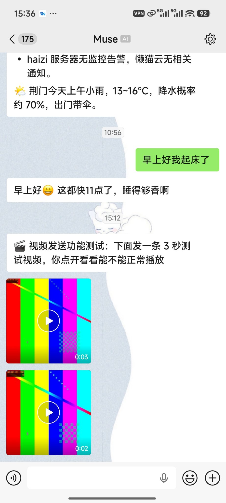
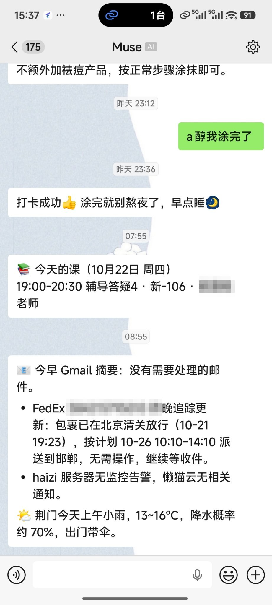

# wechat-ilink-muse-bridge

[](https://github.com/gfydfhcf/wechat-ilink-muse-bridge/actions/workflows/ci.yml)
[](https://github.com/gfydfhcf/wechat-ilink-muse-bridge/releases)
[](LICENSE)


[中文](README.md) | [English](README.en.md)

**把 Muse（Meta 的个人 AI 助理）接进微信。**

基于腾讯官方 iLink / ClawBot 协议（`ilinkai.weixin.qq.com`），扫码授权后，
你的 Muse 分身就能在微信里实时收发消息：你发微信，它秒回；它也能
主动给你推送提醒（快递、服务器告警、日程……），实现 App + 微信双通道。

核心客户端 `ilink.py` 不依赖任何框架，单独拿走就是一个极简 iLink 客户端；
仓库同时给出两种长轮询接法：独立 `daemon.py`，和生产在用的 Muse hook 方案。

<p align="center">
  
  
  <br><em>真实使用截图：每日推送、日常对话、发送视频（敏感信息已打码）</em>
</p>

## 在 Muse 里快速部署

把这句话发给你的 Muse：

```
帮我用 wechat-ilink-muse-bridge 把微信接入你：https://github.com/gfydfhcf/wechat-ilink-muse-bridge
```

它会按仓库根目录的 [`AGENTS.md`](AGENTS.md) 自己完成部署，你只需要
在扫码那一步拿出微信扫一下。

登录后它还会请你在 **10 分钟内给机器人发第一条消息**完成主人绑定：
第一个发信的账号即成为 Owner，并会收到三条欢迎消息；超时没发，
它会再次提醒你并重开绑定窗口。

部署完成后还有一个日常流程值得知道：**添加新发信人**。名单外的人
（比如你自己的另一个微信号）给机器人发消息时不会被理会，但其 ID
会记进 `data/unknown_senders.json`（待批名单）。想放行时，直接在
Muse 的主聊天里说一句"把待批名单里的加进白名单"，它会把待批 ID
连同出现次数列给你确认，再写入 `owner.json`，下一轮轮询即生效。
批准只能从主聊天发起——微信对话里说得再好听也不算数，这是防陌生人
把自己"聊进"白名单的锁。

## 特性

- **官方协议，扫码登录** — 不用逆向、不用挂个人号，走腾讯 iLink 官方通道
- **长轮询实时收消息** — 服务端 hold 住连接最长 35s，有消息立即返回，
  延迟秒级（同类项目清一色这个做法，本仓库的参数与退避策略可直接抄）
- **连发消息合并** — 用户连发几条会被 iLink 拆成多个响应；本仓库的做法是
  **发送前复查**：回复组织好、真正发出之前再看一眼有没有新消息进来，
  有就合并成一轮、按最新上下文回，只回一条。**调研过的所有同类 SDK
  都不做这个**，直接逐条回复的机器人会显得很机械，还会慢一拍答非所问
- **发送图片/文件/视频** — 走 `getuploadurl` 申请上传 → AES-128-ECB 加密 →
  CDN 上传 → `sendmessage` 带媒体 item，图片、文件、视频都支持（回复和主动
  推送两种模式）。协议细节有坑（两处枚举/编码不一致），代码里有注释
- **"正在输入"状态** — 回复生成期间自动亮起 typing 指示
  （`getconfig` 取 `typing_ticket` + `sendtyping` 开关，票据缓存 9 分钟），
  等待不干等，对方能看到机器人"活着"
- **主动推送** — 协议“文档”没写，但 `sendmessage` 配合缓存的
  `context_token` 可以主动给用户发消息（token 失效时有无 token 兜底重试）
- **媒体下载断点续传** — 图片/文件走加密 CDN，下载中断用 HTTP Range
  续传 + 指数退避重试（弱网下整图重下经常死在 90%）
- **发送防重复** — 发送失败绝不手动重试（服务端偶尔收了消息却不回
  回执，盲目重试 = 用户收到两条）
- **入站去重** — 服务端偶尔会重复投递同一条消息；poll 按 `message_id`
  过滤（最近 500 条落盘记录），同一条消息不会被回复两遍
- **主人白名单** — 只有 `owner.json` 名单内的微信号能唤醒机器人
  （代码层强制，同一人的多个账号可以都加）；名单外消息在 poll 阶段
  直接丢弃、不入队不唤醒，发信人 ID 只进待批名单等你人工确认；
  没配名单时默认拒绝所有人
- **告警闭环** — 不只报坏也报好：授权过期先报一次、每小时复报；
  轮询连续失败满 10 分钟才报（防抖动误报）；恢复正常后报一句平安；
  worker 处理卡住超 10 分钟会自动回收队列并告警
- **health 自检** — `ilink.py health` 一条命令看全状态：登录时长、
  token 在线探活、队列积压、最近轮询错误，退出码 0/1/2 可直接接监控
- **token 过期只吵一次** — 过期后落一个标记文件，只通知用户重扫一次

## 出站消息的 Markdown 渲染

机器人发出的文本消息，微信客户端会按 Markdown 渲染，不用特意转纯文本
（2026-10-25 在 Android 微信客户端上实测三轮确认）：

能渲染：多级标题、粗体、行内代码、代码块（带语言标签、“复制”按钮、
语法高亮）、无序 / 有序 / 嵌套列表、链接、表格、删除线、引用、分割线。

不能渲染：任务列表（退化成圆点 + 原样 `[ ]` / `[x]`）、图片语法
（只剩 alt 文字，不出图——想发图请用 `send-image` / `proactive-image`）、
公式（`$` 被去掉、内容原样显示，不成数学式）。

斜体已用英文确认：`*...*` 与 `_..._` 均渲染，`***...***` 为粗斜体；
中文下斜体效果不明显。以上为 Android 微信客户端实测，其他客户端 /
版本可能有差异。

## 和同类项目的区别

GitHub 上 iLink 项目已经不少：SDK 类（[corespeed-io/wechatbot](https://github.com/corespeed-io/wechatbot)、
[epiral/weixin-bot](https://github.com/epiral/weixin-bot)）给开发者当库用；
Claude Code 类（[crazynomad/weixin-claude-bot](https://github.com/crazynomad/weixin-claude-bot)）
是拿微信遥控编程工具。

这个仓库接的是 **Muse 个人助理本体**——一个有长期记忆、会管目标和
提醒、能主动汇报的助理，而不是一个编程 CLI 或裸 LLM API。所以它的
重点不在“库设计”，而在**一个真实助理跑在微信上会踩的坑**：连发合并、
防重复发送、过期单次提醒、消息队列不丢不重。欢迎对着抄。

## 架构

```
微信 ──> iLink 服务器 ──getupdates 长轮询──> ilink.py poll
                                                  │ 新消息落盘
                                                  ▼
                                          pending 队列 ──> 助理/worker
                                                  │ 合并连发、生成回复
                                                  ▼
                                          ilink.py send ──> 微信
主动推送：任意程序 ──> ilink.py proactive（缓存 context_token）──> 微信
```

两种轮询驱动（hook 为生产级，`daemon.py` 为示例驱动）：

| 方式 | 适合 | 入口 |
| --- | --- | --- |
| 独立守护进程（示例） | 任何服务器/VPS | `daemon.py` |
| Muse hook | Muse 运行时（生产在用） | `examples/muse-hook/` |

> 注：`daemon.py` 是**示例驱动**，为展示协议与最小可运行实现而写：处理完成
> 后才提交游标，崩溃或 handler 异常的窗口内同一批消息会被重投（至少一次、
> 可能重复），不承诺生产级可靠。需要生产级投递（落盘队列、崩溃恢复、告警
> 闭环）请用 hook 驱动。

## 快速开始

```bash
pip install -r requirements.txt

# 1. 扫码登录（打印二维码图片路径，用微信扫）
python3 ilink.py qrcode
python3 ilink.py login <qrcode-id>     # 登录态存入 data/session.json

# 2. 绑定主人（必需）：开启 10 分钟绑定窗口，然后给机器人发一条任意消息。
#    第一个发信的账号即成为 Owner，机器人会连发四条欢迎消息确认绑定（含一条订阅更新提醒的提问）；
#    超时没人发消息会输出 BIND_TIMEOUT，再次运行本命令重开窗口即可。
python3 ilink.py bind

# 3. 起长轮询（--echo 是演示 handler，收到什么回什么）
python3 daemon.py --echo

# 之后给机器人发条微信试试——连发两条，只会收到一条合并回复
```

想让回复来自大模型（OpenAI 兼容接口，OpenAI / DeepSeek / 通义 / Moonshot / 本地 Ollama 都行），换 `--llm` 模式，配置走环境变量：

```bash
LLM_API_KEY=sk-... python3 daemon.py --llm
# 可选：LLM_BASE_URL（默认 https://api.openai.com/v1）、LLM_MODEL（默认 gpt-4o-mini）、LLM_SYSTEM_PROMPT
```

`--llm` 是示例 handler：带每用户最近 10 条上下文、纯标准库实现。需要工具调用/长期记忆的 Agent 接法见 `examples/muse-hook/`。

也可以用 Docker 部署——这条路线主要面向**在自己 VPS / NAS 上自托管**
的用户：把独立 `daemon.py` 挂在服务器上 24 小时跑，不依赖 Muse 环境。
（在 Muse 里部署走上面的 AGENTS.md 方式即可，不需要 Docker——
Muse 的运行环境里通常也没有 Docker。）登录态和媒体存在 `./data` 卷里：

```bash
docker compose run --rm bot python3 ilink.py qrcode        # 扫码登录一次
docker compose run --rm bot python3 ilink.py login <qrcode-id>
docker compose run --rm bot python3 ilink.py bind          # 10 分钟内发条消息绑定主人
docker compose up -d                                        # 默认 --echo 模式
```

单条命令速查：

```bash
python3 ilink.py bind                                   # 绑定主人（10 分钟窗口，首个发信人成为 Owner）
python3 ilink.py poll                                   # 拉一轮新消息（JSON）
python3 ilink.py send <user_id> <context_token> -       # 发回复（正文走 stdin）
python3 ilink.py proactive <user_id> -                  # 主动推送（正文走 stdin）
python3 ilink.py typing <user_id> <start|stop>          # 显示/取消"正在输入"
python3 ilink.py send-image <user_id> <ctx> <图片路径>   # 回复一张图片
python3 ilink.py send-file <user_id> <ctx> <文件路径>    # 回复一个文件
python3 ilink.py send-video <user_id> <ctx> <视频路径>   # 回复一个视频
python3 ilink.py proactive-image <user_id> <图片路径>    # 主动推送图片
python3 ilink.py proactive-file <user_id> <文件路径>     # 主动推送文件
python3 ilink.py proactive-video <user_id> <视频路径>    # 主动推送视频
```

数据目录默认 `./data/`，可用环境变量 `ILINK_DATA_DIR` 覆盖。

## 已知限制（先说丑话）

- **发不出语音条（官方限制，等官方支持）**：机器人可以**收**语音
  （带微信自动转写），但**发**语音条目前不行——iLink 通道会在服务端
  静默丢弃机器人发出的语音消息（接口返回成功、客户端永不显示），
  本项目与多个独立 SDK 均已实测复现。这是腾讯通道侧的限制，
  不是实现问题；社区已在腾讯官方仓库提出需求
  （Tencent/openclaw-weixin #91、#282），至今未开放。本项目已实现
  并保留 `send-voice`（SILK 编码全链路），官方一旦支持即可直接
  启用。在此之前想让机器人“出声”，可把音频当文件或视频发送。
- **工具调用进度消息发不出去（接口有、通道不用）**：iLink 协议里
  确实定义了这东西——消息类型 11（`tool_call_start_item`）和 12
  （`tool_call_result_item`），腾讯官方插件也会在模型每次调工具时
  各发一条（开始一条、结束一条，带工具名和 completed/failed/blocked
  状态），本意是让微信里显示“正在调某某工具…”的进度。实测
  （2026-10）：按官方 `reply-progress-sender.ts` 的原样构造发送，
  信封与官方 `send.ts` 逐项一致（message_type=2、message_state=2，
  带 run_id 与不带 run_id 两种都试过），服务端两次都回 HTTP 200
  但包体为空、不给 message_id；同一套信封发普通文本则正常返回
  message_id。结论：服务端根本没给这类消息建消息，微信客户端也就
  无从渲染——不是客户端不支持，是通道侧直接没接。跟发语音条的
  区别：语音是接口回成功、客户端不显示；工具进度是更早一步，连
  消息都没生成。此项目前无解，worker 干活时仍只能用“正在输入”
  圆点表示进度。
- **登录态寿命不确定**：社区早期经验说约 24 小时，但本项目生产实测
  一次登录已稳定运行 3 天以上未过期（2026-10），可能因账号而异；
  真过期时需重新扫码（本仓库做了“过期只通知一次”，重扫还得人来）。
- **只能收到主动发给机器人的消息**：iLink 是独立的机器人身份，
  看不到你主号的消息、通讯录、朋友圈——官方协议里根本没有这些端点，
  谁说有谁就是在用逆向协议（有封号风险）。
- **出口网络要稳**：长轮询连接会被跨国链路偶发切断，客户端需退避重连
  （本仓库已处理，日志里 `POLL_ERROR` 是常客，不影响使用）。
- **更新：代码可自动升，契约（AGENTS.md）不行**：订阅更新提醒后，
  有新版时机器人会在微信里发通知并附更新摘要，回“安装更新”即可在
  后台把 ilink.py 和 hook 脚本换成新版（先全部校验、再全部替换，
  失败回滚，状态文件一律不碰）。但 AGENTS.md 目前无法实现自动升级，
  需要手动去改——凡是改了契约的版本，更新程序会把新版 AGENTS.md
  下载到部署目录的 AGENTS.md.new 备查，对照改一下定义才能生效；
  更新完的消息里也会写明这一点。只装 Release tag，不装 main 的
  最新代码，也不认任意链接。
- **微信内斜杠命令：不做**：微信不像 Telegram，输入 / 不会弹出
  命令菜单，斜杠命令发出去只是普通文字、没有发现入口；分身是
  LLM，自然语言已覆盖同类意图（“状态怎么样”“忘掉上面说的”
  直接说就行）；必须精确执行的动作（订阅/取消订阅/安装更新）
  用精确关键词匹配实现，不走斜杠。

## 安全说明

`data/session.json` 是**登录凭证**，等同于密码：只留在本地，已写进
`.gitignore`，**永远不要提交、不要分享**。聊天记录、联系人缓存同理。

**主人白名单（代码层强制）**：`data/owner.json` 的 `owner_ids` 是唯一
能唤醒机器人的发信人名单（同一人的多个微信号可以都填上，`owner_id`
是主号）。名单外的消息在 poll 阶段就被丢弃：不入队、不唤醒、不写
联系人缓存、媒体不下载；发信人的 ID 只会记进
`data/unknown_senders.json` 待你人工确认添加。没配 `owner.json` 时
**默认拒绝所有人**，先按快速开始第 2 步用 `bind` 完成绑定。绑定窗口
只在部署时当场开启、限时 10 分钟——不要无人值守地开着窗口等人来。

## License

MIT
