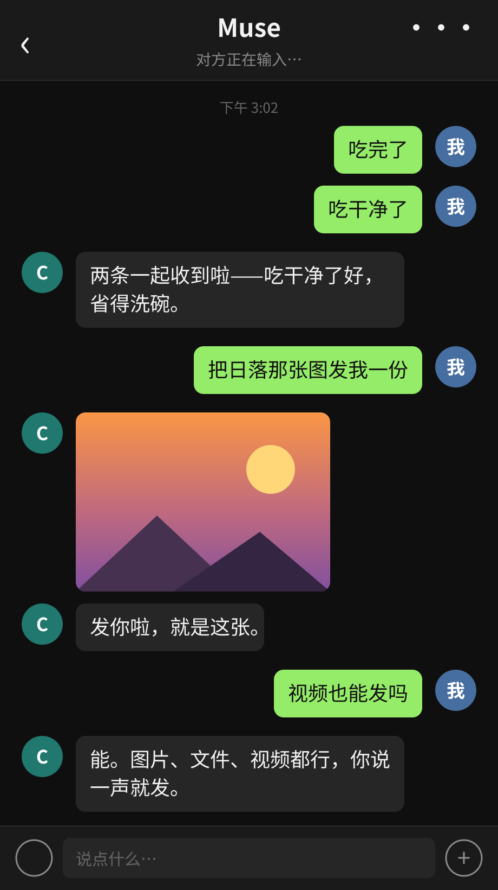

# wechat-ilink-muse-bridge

[中文](README.md) | [English](README.en.md)

**把 Muse（Meta 的个人 AI 助理）接进微信。**

基于腾讯官方 iLink / ClawBot 协议（`ilinkai.weixin.qq.com`），扫码授权后，
你的 Muse 分身就能在微信里实时收发消息：你发微信，它秒回；它也能
主动给你推送提醒（快递、服务器告警、日程……），实现 App + 微信双通道。

核心客户端 `ilink.py` 不依赖任何框架，单独拿走就是一个极简 iLink 客户端；
仓库同时给出两种长轮询接法：独立 `daemon.py`，和生产在用的 Muse hook 方案。

<p align="center">
  
  <br><em>演示效果：连发消息合并回复、"正在输入"状态、发送图片/视频</em>
</p>

## 在 Muse 里快速部署

把这句话发给你的 Muse：

```
帮我用 wechat-ilink-muse-bridge 把微信接入你：https://github.com/gfydfhcf/wechat-ilink-muse-bridge
```

它会按仓库根目录的 [`AGENTS.md`](AGENTS.md) 自己完成部署，你只需要
在扫码那一步拿出微信扫一下。

## 特性

- **官方协议，扫码登录** — 不用逆向、不用挂个人号，走腾讯 iLink 官方通道
- **长轮询实时收消息** — 服务端 hold 住连接最长 35s，有消息立即返回，
  延迟秒级（同类项目清一色这个做法，本仓库的参数与退避策略可直接抄）
- **连发消息合并** — 用户连发几条会被 iLink 拆成多个响应；本仓库的做法是
  **发送前复查**：回复组织好、真正发出之前再看一眼有没有新消息进来，
  有就合并成一轮、按最新上下文回，只回一条。**调研过的所有同类 SDK
  都不做这个**，直接逐条回复的机器人会显得很机械，还会慢一拍答非所问
- **发送图片/文件/视频** — 走 `getuploadurl` 申请上传 → AES-128-ECB 加密 →
  CDN 上传 → `sendmessage` 带媒体 item，图片、文件、视频都支持（回复和主动
  推送两种模式）。协议细节有坑（两处枚举/编码不一致），代码里有注释
- **"正在输入"状态** — 回复生成期间自动亮起 typing 指示
  （`getconfig` 取 `typing_ticket` + `sendtyping` 开关，票据缓存 9 分钟），
  等待不干等，对方能看到机器人"活着"
- **主动推送** — 协议“文档”没写，但 `sendmessage` 配合缓存的
  `context_token` 可以主动给用户发消息（token 失效时有无 token 兜底重试）
- **媒体下载断点续传** — 图片/文件走加密 CDN，下载中断用 HTTP Range
  续传 + 指数退避重试（弱网下整图重下经常死在 90%）
- **发送防重复** — 发送失败绝不手动重试（服务端偶尔收了消息却不回
  回执，盲目重试 = 用户收到两条）
- **入站去重** — 服务端偶尔会重复投递同一条消息；poll 按 `message_id`
  过滤（最近 500 条落盘记录），同一条消息不会被回复两遍
- **token 过期只吵一次** — 过期后落一个标记文件，只通知用户重扫一次

## 和同类项目的区别

GitHub 上 iLink 项目已经不少：SDK 类（[corespeed-io/wechatbot](https://github.com/corespeed-io/wechatbot)、
[epiral/weixin-bot](https://github.com/epiral/weixin-bot)）给开发者当库用；
Claude Code 类（[crazynomad/weixin-claude-bot](https://github.com/crazynomad/weixin-claude-bot)）
是拿微信遥控编程工具。

这个仓库接的是 **Muse 个人助理本体**——一个有长期记忆、会管目标和
提醒、能主动汇报的助理，而不是一个编程 CLI 或裸 LLM API。所以它的
重点不在“库设计”，而在**一个真实助理跑在微信上会踩的坑**：连发合并、
防重复发送、过期单次提醒、消息队列不丢不重。欢迎对着抄。

## 架构

```
微信 ──> iLink 服务器 ──getupdates 长轮询──> ilink.py poll
                                                  │ 新消息落盘
                                                  ▼
                                          pending 队列 ──> 助理/worker
                                                  │ 合并连发、生成回复
                                                  ▼
                                          ilink.py send ──> 微信
主动推送：任意程序 ──> ilink.py proactive（缓存 context_token）──> 微信
```

两种轮询驱动任选其一：

| 方式 | 适合 | 入口 |
| --- | --- | --- |
| 独立守护进程 | 任何服务器/VPS | `daemon.py` |
| Muse hook | Muse 运行时（生产在用） | `examples/muse-hook/` |

## 快速开始

```bash
pip install -r requirements.txt

# 1. 扫码登录（打印二维码图片路径，用微信扫）
python3 ilink.py qrcode
python3 ilink.py login <qrcode-id>     # 登录态存入 data/session.json

# 2. 起长轮询（--echo 是演示 handler，收到什么回什么）
python3 daemon.py --echo

# 之后给机器人发条微信试试——连发两条，只会收到一条合并回复
```

想让回复来自大模型（OpenAI 兼容接口，OpenAI / DeepSeek / 通义 / Moonshot / 本地 Ollama 都行），换 `--llm` 模式，配置走环境变量：

```bash
LLM_API_KEY=sk-... python3 daemon.py --llm
# 可选：LLM_BASE_URL（默认 https://api.openai.com/v1）、LLM_MODEL（默认 gpt-4o-mini）、LLM_SYSTEM_PROMPT
```

`--llm` 是示例 handler：带每用户最近 10 条上下文、纯标准库实现。需要工具调用/长期记忆的 Agent 接法见 `examples/muse-hook/`。

或者用 Docker 一键部署（登录态和媒体都存在 `./data` 卷里）：

```bash
docker compose run --rm bot python3 ilink.py qrcode        # 扫码登录一次
docker compose run --rm bot python3 ilink.py login <qrcode-id>
docker compose up -d                                        # 默认 --echo 模式
```

单条命令速查：

```bash
python3 ilink.py poll                                   # 拉一轮新消息（JSON）
python3 ilink.py send <user_id> <context_token> -       # 发回复（正文走 stdin）
python3 ilink.py proactive <user_id> -                  # 主动推送（正文走 stdin）
python3 ilink.py typing <user_id> <start|stop>          # 显示/取消"正在输入"
python3 ilink.py send-image <user_id> <ctx> <图片路径>   # 回复一张图片
python3 ilink.py send-file <user_id> <ctx> <文件路径>    # 回复一个文件
python3 ilink.py send-video <user_id> <ctx> <视频路径>   # 回复一个视频
python3 ilink.py proactive-image <user_id> <图片路径>    # 主动推送图片
python3 ilink.py proactive-file <user_id> <文件路径>     # 主动推送文件
python3 ilink.py proactive-video <user_id> <视频路径>    # 主动推送视频
```

数据目录默认 `./data/`，可用环境变量 `ILINK_DATA_DIR` 覆盖。

## 已知限制（先说丑话）

- **登录态寿命不确定**：社区早期经验说约 24 小时，但本项目生产实测
  一次登录已稳定运行 3 天以上未过期（2026-10），可能因账号而异；
  真过期时需重新扫码（本仓库做了“过期只通知一次”，重扫还得人来）。
- **只能收到主动发给机器人的消息**：iLink 是独立的机器人身份，
  看不到你主号的消息、通讯录、朋友圈——官方协议里根本没有这些端点，
  谁说有谁就是在用逆向协议（有封号风险）。
- **出口网络要稳**：长轮询连接会被跨国链路偶发切断，客户端需退避重连
  （本仓库已处理，日志里 `POLL_ERROR` 是常客，不影响使用）。

## 安全说明

`data/session.json` 是**登录凭证**，等同于密码：只留在本地，已写进
`.gitignore`，**永远不要提交、不要分享**。聊天记录、联系人缓存同理。

## License

MIT
